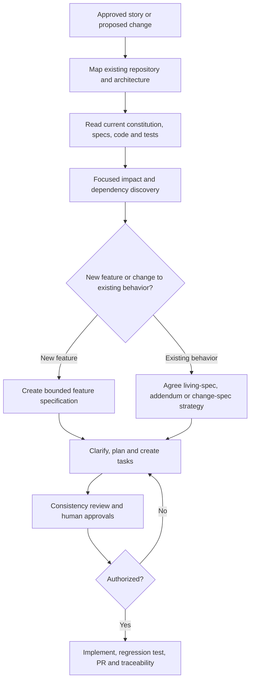

# Brownfield — Spec Kit SDD: Start Here

**Use this when:** existing application or service.

> Status: developer adoption guidance for review, not approved enterprise policy. Follow existing ADO, architecture, security, and PR approvals. Diagram stages are a navigation aid, not an automated approval mechanism.

[← Choose Greenfield or Brownfield](../README.md) · [Full developer guide](./developer-guide.md) · [Process diagram only](./process-flow.md)

## Process at a glance

## Click a step to read only what you need

| Step | What to do | Relevant guidance |
|---|---|---|
| 1 | Map repository and select workspace | [Open detailed instructions](./developer-guide.md) |
| 2 | Review existing constitution and approved baseline | [Open detailed instructions](./developer-guide.md#11-what-a-constitution-is) |
| 3 | Discover code and dependencies | [Open detailed instructions](./developer-guide.md) |
| 4 | Decide new feature vs existing change | [Open detailed instructions](./developer-guide.md#41-what-is-specification-evolution) |
| 5 | Specify, clarify, plan and tasks | [Open detailed instructions](./developer-guide.md#33-practical-workflow-for-feature-2-onward) |
| 6 | Analyze and obtain approvals | [Open detailed instructions](./developer-guide.md#33-practical-workflow-for-feature-2-onward) |
| 7 | Implement and run regression tests | [Open detailed instructions](./developer-guide.md#59-risk-based-regression-and-change-control) |

## Before you start

- Confirm the source story/change, owner, acceptance criteria and approval status.
- Verify the repository and the installed Spec Kit commands rather than assuming every alias exists.
- Keep AI-generated drafts and experimental changes separate from approved requirements.
- Never treat `/speckit.analyze` or passing existing tests as proof of business approval or complete regression coverage.

## What to share with your team

Send this `README.md` link first. The flow shows the journey; the table opens the exact guidance; `developer-guide.md` preserves the detailed examples, prompts, and pilot evidence.
