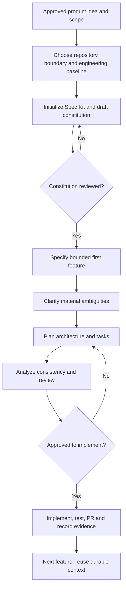

# Greenfield — Spec Kit SDD: Start Here

**Use this when:** new application or service.

> Status: developer adoption guidance for review, not approved enterprise policy. Follow existing ADO, architecture, security, and PR approvals. Diagram stages are a navigation aid, not an automated approval mechanism.

[← Choose Greenfield or Brownfield](../README.md) · [Full developer guide](./developer-guide.md) · [Process diagram only](./process-flow.md)

## Process at a glance

## Click a step to read only what you need

| Step | What to do | Relevant guidance |
|---|---|---|
| 1 | Define scope and repository boundary | [Open detailed instructions](./developer-guide.md#11-before-installing-spec-kit) |
| 2 | Initialize Spec Kit | [Open detailed instructions](./developer-guide.md#12-initialize-at-the-repository-boundary) |
| 3 | Draft and review constitution | [Open detailed instructions](./developer-guide.md#13-constitution-durable-rules-not-feature-requirements) |
| 4 | Specify and clarify first feature | [Open detailed instructions](./developer-guide.md#23-feature-lifecycle) |
| 5 | Plan, tasks and consistency review | [Open detailed instructions](./developer-guide.md#23-feature-lifecycle) |
| 6 | Implement, test and review | [Open detailed instructions](./developer-guide.md#25-what-developers-must-verify) |
| 7 | Reuse context for later stories | [Open detailed instructions](./developer-guide.md#chapter-3--subsequent-features-and-reusable-context) |

## Before you start

- Confirm the source story/change, owner, acceptance criteria and approval status.
- Verify the repository and the installed Spec Kit commands rather than assuming every alias exists.
- Keep AI-generated drafts and experimental changes separate from approved requirements.
- Never treat `/speckit.analyze` or passing existing tests as proof of business approval or complete regression coverage.

## What to share with your team

Send this `README.md` link first. The flow shows the journey; the table opens the exact guidance; `developer-guide.md` preserves the detailed examples, prompts, and pilot evidence.
