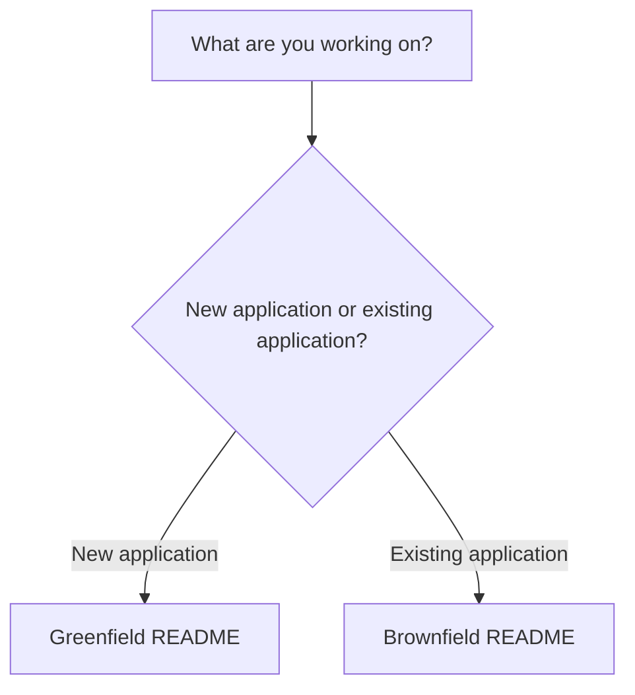

# Spec Kit — SDD Developer Guides

**Start here. Choose the situation that matches your work.** These are proposed team guidance, not an enterprise-approved policy.

| Your situation | Start here | Visual process | Detailed reference |
|---|---|---|---|
| **Greenfield** — building a new application or service | [Greenfield README](./Greenfield/README.md) | [Greenfield flow](./Greenfield/process-flow.md) | [Greenfield developer guide](./Greenfield/developer-guide.md) |
| **Brownfield** — adding or changing functionality in an existing system | [Brownfield README](./Brownfield/README.md) | [Brownfield flow](./Brownfield/process-flow.md) | [Brownfield developer guide](./Brownfield/developer-guide.md) |

## Usage notes

1. Open the matching README, view the process diagram, then click a step in its navigation table.
2. Read only the detailed section relevant to your work; use the complete guide for complex cases.
3. Follow the team's existing ADO, security, architecture, QA, and PR processes.
4. Diagram boxes are intentionally not clickable: GitHub Mermaid node-link behavior varies. The Markdown tables provide dependable hyperlinks.

**Repository convention:** Keep these Markdown files under `Guides/Spec Driven Development/SpecKit/` and update links when moving files.
